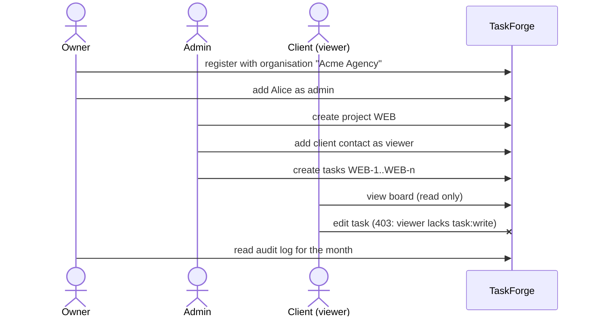

# Product: vision and requirements

## Vision

TaskForge is work tracking for companies that sell to other companies and need
each customer's work kept strictly apart: agencies, consultancies and B2B teams
running projects for many clients. It aims to be as quick as a personal to-do
board while giving admins the controls an enterprise buyer asks for in the
security questionnaire: roles, isolation and an audit trail.

**Who it's for.** Team leads who plan the work, members who do it, and the
organisation owner who has to answer "who changed this, and when?".

## Business problem

| Today | Cost |
|---|---|
| One shared tracker for all clients | A mis-click exposes one client's plans to another; a contractual risk |
| Everyone is an admin | Accidental deletes; no way to give a client read-only access |
| No history of changes | Disputes about scope and dates are settled from memory |
| Tools bolted together over spreadsheets | Duplicate task numbers, lost work |

## Business requirements

| ID | Requirement |
|---|---|
| BR-1 | An organisation's data is visible only to its members. |
| BR-2 | Four roles: owner, admin, member, viewer, each a superset of the next. |
| BR-3 | Only the owner can grant or revoke admin, and the owner's role can't be changed. |
| BR-4 | Projects have a short key; tasks get sequential, human-friendly references (`WEB-42`). |
| BR-5 | Every change to members, projects and tasks is recorded with who, what and when. |
| BR-6 | Tasks move across a board: backlog, todo, in progress, in review, done. |
| BR-7 | Sign-up and sign-in with email and password; brute force is throttled. |

## Technical requirements

| ID | Requirement | How it is met |
|---|---|---|
| TR-1 | Tenant isolation | Membership resolved per request; every query filters on `org_id`; cross-tenant IDs return `404` |
| TR-2 | Authorisation reviewable in one place | Permission matrix as data in `rbac.ts`, tested for monotonicity |
| TR-3 | Contract safety between web and API | Zod schemas in `packages/shared` used by both |
| TR-4 | Gap-free task numbers under concurrency | Atomic counter `UPDATE ... RETURNING` in the same transaction as the insert |
| TR-5 | Audit atomic with the change | Audit row written in the same database transaction, with a field-level diff |
| TR-6 | Credential safety | scrypt, constant-time compare, equal timing for unknown emails, rate-limited auth routes |
| TR-7 | Latency | p95 under 150 ms for board reads with 2,000 tasks per project (target, M6) |

## Out of scope (for now)

SSO/SAML (M7), file attachments, time tracking, billing.

## Business workflow: onboarding a client team

